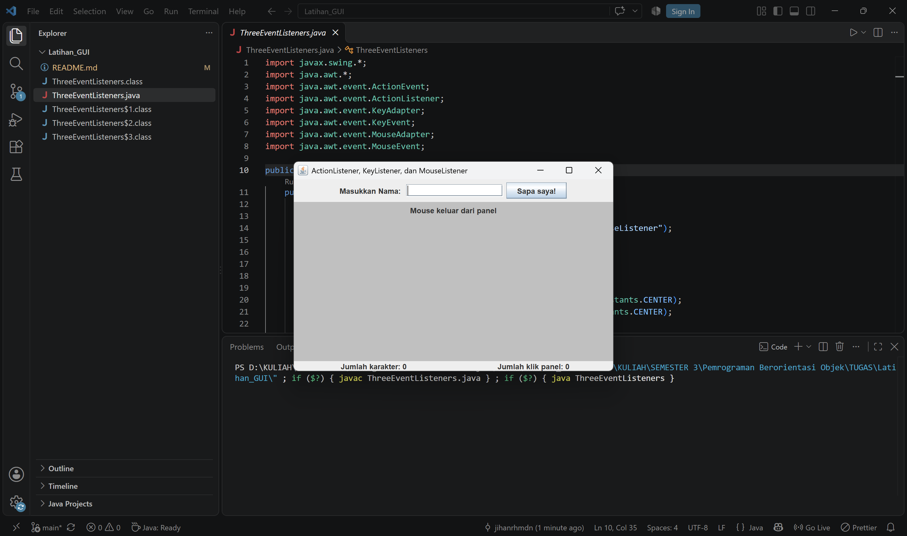
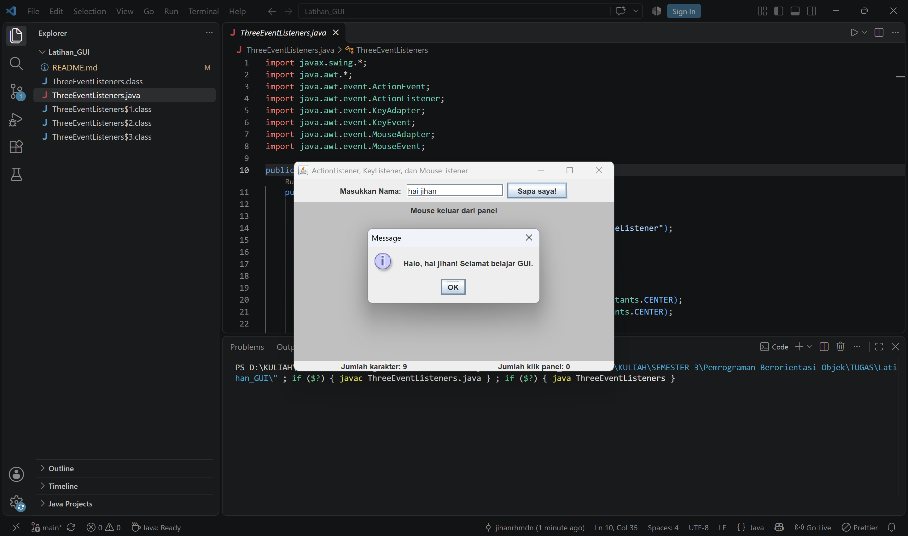
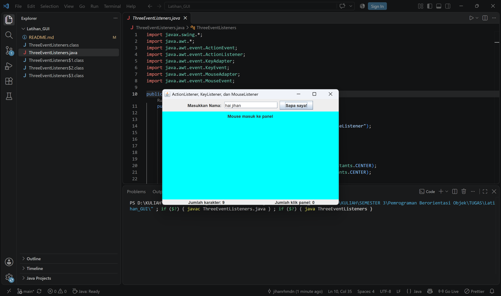

# Eksplorasi GUI Java Swing: ThreeEventListeners

**Nama:** (Jihan Rahmadani)
**NIM:** (F1D02510060)
**Kelas:** (B)

## Deskripsi

Program GUI Java Swing untuk latihan lima komponen utama GUI. Pengguna memasukkan nama lalu menekan tombol untuk disapa, jumlah karakter yang diketik dihitung otomatis, dan sebuah panel merespons gerakan serta klik mouse.

## Cara Menjalankan

```
javac ThreeEventListeners.java
java ThreeEventListeners
```

## Lima Komponen Utama GUI yang Digunakan

| No | Komponen | Class / Interface | Fungsi di program ini |
|----|----------|-------------------|-----------------------|
| 1 | Top-level Container | `JFrame` | Jendela utama aplikasi tempat semua komponen diletakkan. |
| 2 | Intermediate Container | `JPanel` | Tiga panel: `panelInput` (isian nama dan tombol), `panelMouse` (kotak abu-abu), dan `panelInfo` (label informasi). |
| 3 | Atomic Component | `JLabel`, `JTextField`, `JButton` | `JLabel` menampilkan teks dan informasi, `JTextField` menerima input nama, `JButton` memicu sapaan. |
| 4 | Layout | `BorderLayout`, `FlowLayout`, `GridLayout` | `BorderLayout` menyusun frame (atas, tengah, bawah), `FlowLayout` menyusun `panelInput`, `GridLayout` (1x2) menyusun `panelInfo`. |
| 5 | Event Listener | `ActionListener` (interface), `KeyAdapter` dan `MouseAdapter` (adapter class) | `ActionListener` meng-override `actionPerformed()` untuk tombol. `KeyAdapter` meng-override `keyReleased()` untuk menghitung karakter. `MouseAdapter` meng-override `mouseEntered()`, `mouseExited()`, dan `mouseClicked()` untuk panel. |

## Screenshot

Tampilan awal:



Saat menekan tombol "Sapa saya!":



Saat mouse berada di atas panel:


